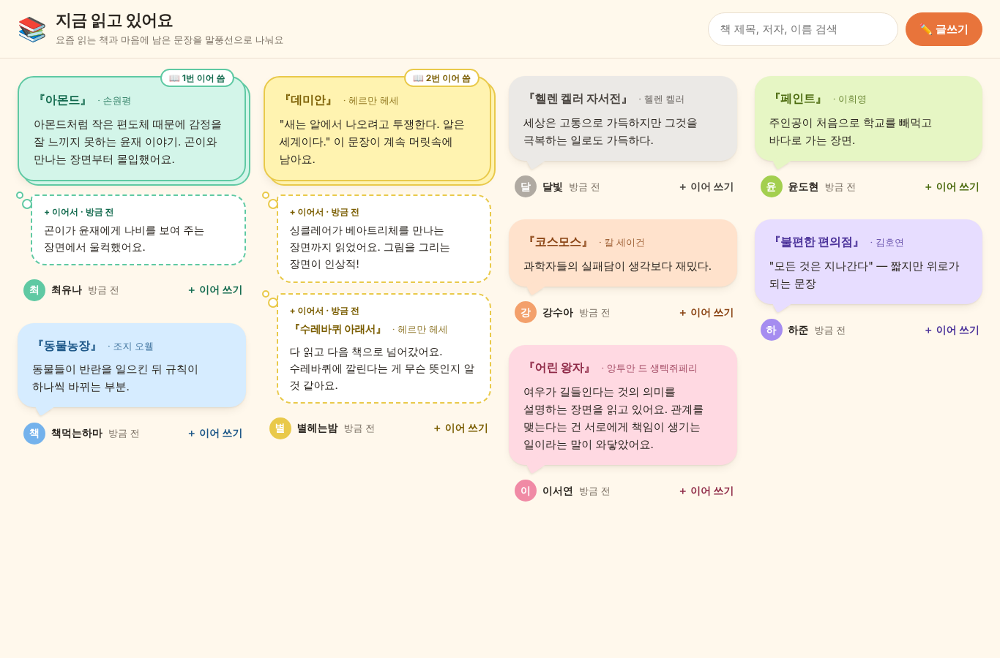
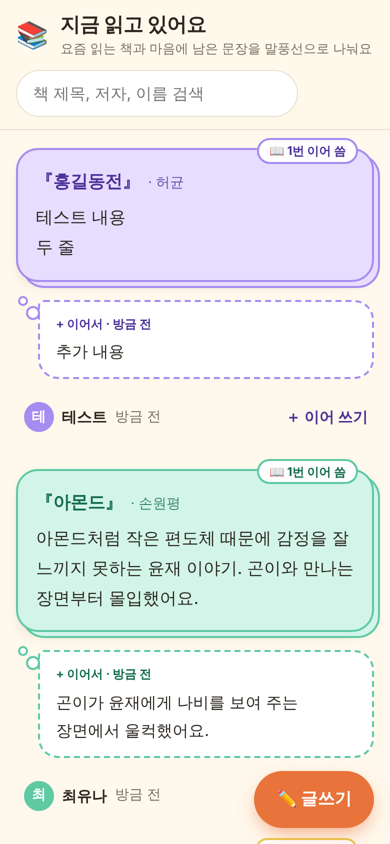
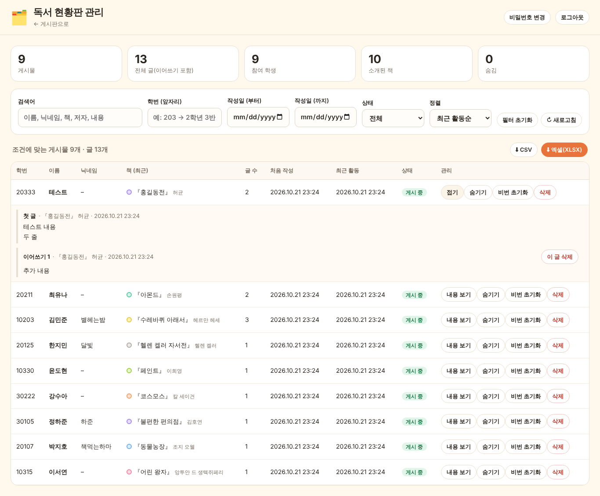

# 📚 봉일천고 독서나눔 릴레이

학생들이 지금 읽고 있는 책과 마음에 남은 문장을 **말풍선**으로 소개하는 가벼운 게시판입니다.
Padlet 처럼 누구나 바로 글을 올릴 수 있지만, 파일 업로드 없이 글만 쓰도록 단순하게 만들었습니다.

| PC 화면 | 휴대폰 화면 |
|---|---|
|  |  |

## 기능

**학생 (index.html)**
- 글쓰기 창에서 **🎒 학생 / 🍎 교사** 를 고릅니다. 학생은 학번, 교사는 **부서**를 넣고 이름, 닉네임(선택), 비밀번호 4자리를 넣습니다.
- 내용: ① 읽고 있는 내용이나 기억에 남는 문구(500자까지) ② 책 제목 ③ 저자
- 학생은 말풍선 색 8가지 중 하나를 고릅니다. **교사 글은 편지지 모양의 전용 말풍선**("🍎 선생님의 책")으로 보입니다.
- 말풍선 아래에 **학번(교사는 부서) · 이름 · 닉네임** 순서로 표시됩니다.
- **댓글**: 말풍선 아래 [💬 댓글 n] 을 누르면 댓글을 보고 남길 수 있습니다. 학번(교사는 부서)·이름·비밀번호 4자리가 필요하고, 같은 비밀번호로 내 댓글을 지울 수 있습니다. 댓글은 200자까지, 20초에 1개까지, 말풍선 하나에 100개까지입니다.
- 6줄이 넘는 긴 글은 접혀 있고 **더 읽기** 로 펼칩니다. 방금 쓴 말풍선은 잠깐 빛나며 그 자리로 이동합니다.
- 같은 기기에서는 학번·이름이 다음 글쓰기·댓글에 자동으로 채워집니다(비밀번호는 저장하지 않음).
- 첫 화면 맨 앞에 **작성 예시 말풍선** 1개가 보이고(실제 글이 10개가 넘으면 자동으로 숨김), **👀 예시 화면** 버튼을 누르면 말풍선으로 가득 찬 예시 게시판을 볼 수 있습니다(가상의 글이며 저장되지 않습니다).
- 배경 무늬(`img/bg-pattern.svg`)는 이 프로젝트를 위해 직접 그린 그림이라 저작권 걱정 없이 쓸 수 있습니다.
- **이어 쓰기**: 비밀번호를 넣으면 내 말풍선에 내용을 더할 수 있습니다. 이어 쓴 게시물은
  겹친 종이 모양 + "📖 n번 이어 씀" 표시가 붙고, 추가된 글은 점선 생각 풍선으로 아래에 이어집니다.
  다른 책으로 넘어가면 책 제목도 바꿔 적을 수 있습니다.
- 휴대폰에서는 한 줄 배치, 큰 글씨, 아래에서 올라오는 입력창, 오른쪽 아래 [글쓰기] 버튼으로 바뀝니다.
- 검색(책 제목·저자·이름·내용), 20초마다 자동 새로고침.
- 비밀번호를 5번 틀리면 그 게시물은 10분 동안 잠깁니다.
- **내 글 고치기·지우기**: 말풍선의 [✎ 수정] → 비밀번호를 넣고 첫 글이나 이어 쓴 글을 고치거나 지울 수 있습니다(첫 글을 지우면 말풍선 전체가 지워짐).
- **도배 방지**: 같은 학번·이름으로는 1분에 새 글 1개, 한 말풍선에는 1분에 이어쓰기 1개까지만 됩니다.
- **금지어**: 금지어가 들어간 글은 게시되지 않습니다(기호·숫자를 끼워 넣어도 걸러짐). 목록은 관리자 화면 ⚙️ 설정에서 고칩니다.
- **교사 인증 코드**: 교사로 글을 쓰려면 관리자가 정한 코드를 입력해야 합니다. 코드는 관리자 화면 ⚙️ 설정에서 정하며, 저장소에는 남지 않습니다.
- 학생 화면은 검색엔진에 노출되지 않도록 `noindex` 가 설정되어 있습니다.

**관리자 (admin.html)**



- 관리자 비밀번호로 로그인
- 필터: 검색어, 학번/부서 앞부분(예: `203` → 2학년 3반), 작성 기간, 게시/숨김 상태, 학생/교사 구분, 정렬
- 게시물 **숨기기/보이기**, **삭제**(게시물 전체 또는 이어 쓴 글 하나), 학생 **비밀번호 초기화**
- [내용 보기] 에서 그 말풍선의 **댓글을 보고 하나씩 삭제**
- 필터 결과를 **CSV** 또는 **엑셀(XLSX)** 로 내려받기
  - 엑셀은 `전체 기록`(글 하나당 한 줄), `학생별 요약`(학생별 글 수·받은 댓글·읽은 책), `댓글` 세 시트로 나옵니다.

## 구조

- 화면: HTML/CSS/JavaScript 만으로 된 정적 웹페이지 → **GitHub Pages** 로 무료 공개
- 데이터: **Supabase**(무료 Postgres DB). 여러 학생이 동시에 써도 모두 한곳에 저장됩니다.
- 학생 화면은 DB 표를 직접 읽거나 쓰지 못하고, `supabase/schema.sql` 에 정의된 함수로만 접근합니다.
  비밀번호는 암호화(bcrypt)되어 저장되고, 학번·이름은 관리자 함수로만 볼 수 있습니다.

```
index.html          학생 게시판
admin.html          관리자 화면
css/style.css       게시판 디자인 (말풍선, 색상, 모바일)
css/admin.css       관리자 화면 디자인
js/config.js        ← Supabase 주소와 키를 넣는 곳
js/common.js        공통 도우미 (서버 호출 등)
js/board.js         게시판 동작
js/admin.js         관리자 동작 (필터, 내보내기)
supabase/schema.sql DB 설정 (Supabase SQL Editor 에서 한 번 실행)
```

---

## 설치 방법 (처음 한 번, 약 15분)

### 1. Supabase 프로젝트 만들기
1. <https://supabase.com> 에 가입(GitHub 계정으로 로그인 가능)합니다.
2. **New project** → 이름(예: `book-board`), DB 비밀번호(아무 값이나, 따로 보관), Region 은 **Northeast Asia (Seoul)** 을 고르고 만듭니다.

### 2. DB 설정하기
1. 왼쪽 메뉴 **SQL Editor** → **New query**
2. 이 저장소의 [`supabase/schema.sql`](supabase/schema.sql) 내용을 모두 복사해 붙여 넣습니다.
3. 맨 아래 줄의 `'여기에-관리자-비밀번호'` 를 **원하는 관리자 비밀번호(6자 이상)** 로 바꿉니다.
4. **Run** 을 누릅니다. `Success` 가 나오면 끝입니다.

### 3. 주소와 키를 화면에 연결하기
1. Supabase 왼쪽 아래 **Project Settings** → **API**(또는 **Data API** / **API Keys**) 로 갑니다.
2. **Project URL** 과 **anon public** 키(또는 **Publishable key**)를 복사합니다.
   ⚠️ `service_role` / `secret` 키는 절대 쓰지 마세요.
3. GitHub 에서 [`js/config.js`](js/config.js) 를 열고 연필(✏️) 아이콘으로 편집해 두 값을 바꾼 뒤 **Commit changes** 합니다.
   ```js
   SUPABASE_URL: "https://abcdefgh.supabase.co",
   SUPABASE_ANON_KEY: "eyJhbGciOi...",   // 또는 "sb_publishable_..."
   ```
   게시판 이름(`TITLE`)과 안내 문구(`SUBTITLE`)도 여기서 바꿀 수 있습니다.

### 4. GitHub Pages 로 공개하기
1. 저장소 **Settings** → **Pages**
2. **Source: Deploy from a branch**, **Branch: `main`**, 폴더 **`/ (root)`** → **Save**
3. 1~2분 뒤 아래 주소로 접속됩니다.
   - 학생용: `https://2023swhs3rd-a11y.github.io/book/`
   - 관리자용: `https://2023swhs3rd-a11y.github.io/book/admin.html`

학생들에게는 학생용 주소(또는 QR 코드)만 알려 주세요.

---

## 기능 업데이트 후 DB 반영

저장소의 `supabase/schema.sql` 이 바뀌었을 때는 **파일 전체를 다시 SQL Editor 에 붙여 넣고 Run** 하세요.
기존 게시물과 관리자 비밀번호는 그대로 남습니다(맨 아래 비밀번호 줄은 처음 한 번만 적용되므로 바꾸지 않아도 됩니다).

> 화면 파일(css/js)을 고친 경우에는 `index.html`, `admin.html` 의 `?v=날짜` 값을 함께 바꿔 주세요.
> 그래야 학생들 브라우저가 예전 파일을 쓰지 않고 새 파일을 받아 옵니다.

## 운영 팁

- **무료 요금제 일시 정지**: Supabase 무료 프로젝트는 **7일 동안 아무도 접속하지 않으면 일시 정지**됩니다.
  방학 뒤 게시판이 안 열리면 Supabase 대시보드에서 프로젝트를 열고 **Restore/Resume** 를 누르세요(데이터는 그대로 남아 있습니다).
  학기 말에는 관리자 화면에서 엑셀로 백업해 두기를 권합니다.
- **학생이 비밀번호를 잊었을 때**: 관리자 화면 → 해당 학생 줄의 **비번 초기화** 로 새 4자리를 정해 알려 주세요.
- **부적절한 글**: 먼저 **숨기기**(학생 화면에서만 사라지고 기록은 남음), 필요하면 **삭제**(되돌릴 수 없음).
- **관리자 비밀번호 변경**: 관리자 화면 오른쪽 위 **비밀번호 변경**. 잊어버렸다면 Supabase SQL Editor 에서 아래를 실행하세요.
  ```sql
  update admin_config set pw_hash = extensions.crypt('새비밀번호', extensions.gen_salt('bf')),
         fail_count = 0, locked_until = null where id = 1;
  ```
- **새 학기에 비우기**: 엑셀로 백업한 뒤 SQL Editor 에서 `truncate posts, entries, comments restart identity;` 를 실행합니다.
- 글자 수 제한: 내용 500자, 책 제목 100자, 저자 50자, 이름·닉네임 20자, 이어 쓰기는 게시물당 30번까지, 댓글 200자·말풍선당 100개까지.
